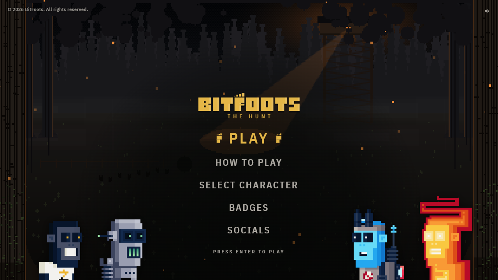

# Bitfoot: The Hunt

A browser stealth game that teaches how Zcash shielded payments work, one footprint at a time.



Educational game. Not financial advice; it uses no real funds and touches no real wallets.

Not affiliated with or endorsed by the Zcash Foundation or Electric Coin Co.

## What it is

You play a Bitfoot carrying coins home across a map. Every step you take on land leaves a footprint, and the hunters can follow those prints for as long as they like. That is transparent ZEC: who paid, who got paid and how much, all public, forever.

The shielded waters are different. In the water you leave no footprints. The waters are the shielded pool: you can get paid, hold coins and pay people inside them, and from the shore every coin looks the same. The shore still sees where you jumped in, how much you carried, and when you climbed back out.

Each level teaches one real Zcash idea, listed with its real Zcash term in the table below. You learn it by making the mistake safely and watching what the hunters can now see.

## How to play

Play it at: https://bitfoots-trail-production.up.railway.app

No sign-up and no login: open the link and play. Your progress is saved in your browser.

Controls: WASD or the arrow keys to move (drag on a touch screen), Shift to sprint, Esc to pause.

## The levels

Twelve levels in four acts, numbered from 0 as the game shows them. The order is `window.TRAIL_ORDER` in `site/levels/levels.js`; each level's term is in the `TERMS` table in `site/levels/order.js`.

| # | Level | The idea | The real Zcash term |
|---|---|---|---|
| 0 | YOUR WALLET | Your secret words back up your wallet, and whoever has them has the coins. | Seed phrase |
| 1 | YOUR FIRST PAYMENT | You approve a payment by signing it, and a tiny fee goes to the network. | Zatoshi |
| 2 | WALLET TRACKERS | Every step on land leaves footprints anyone can follow, even years later. | Transparent ZEC; the standard fee of 10,000 zatoshis |
| 3 | GOING PRIVATE | The waters hide your footprints, but everyone sees where you went in and how much you brought. | Shielding |
| 4 | LIFE IN THE WATERS | You can get paid and pay inside the waters; climbing out shows how much you took. | Note; fully shielded payment; nullifier; encrypted memo |
| 5 | LINKING THE DOTS | Land addresses are public: shield each one on its own trip, never together. | Diversified addresses; shielded pool; unified address (u1) |
| 6 | THE GLASS KEY | Whoever gets your glass key sees every trip in the waters, but can never spend. | Full viewing key |
| 7 | THE CAMPFIRE | Whoever has your words owns your coins, so never share them. | Spending key |
| 8 | ALL TOGETHER | The finale: stay in the waters, keep your words, approve every leak yourself. | Ironwood |
| 9 | THE NEW WATERS | The old waters are sealed: coins can leave it but not go in, so you carry them over. | Migration; proofs with Halo 2 |
| 10 | THE EXCHANGE | Some exchanges only take public coins, so paying one means climbing out in view. | TEX address |
| 11 | THE LYING POST OFFICE | A post office you don't run can hide your mail, but can't take your coins. | Full node, like Zebra |

Each level in more detail: [docs/LEVELS.md](docs/LEVELS.md).

## Why it is accurate

The game follows [docs/ZEC-RULEBOOK.md](docs/ZEC-RULEBOOK.md). Every rule in it quotes an official Zcash source word for word and links to it: the protocol specification and the ZIPs on zips.z.cash, the Zcash documentation on zcash.readthedocs.io, and the Zebra, Zaino and Zallet READMEs. Each rule says what the game must show and what it must never claim. Anything that could not be sourced is listed as unsourced and is never shown as fact.

## How it works

- **The game** is plain JavaScript on an HTML canvas, with no framework and no npm packages. `site/index.html` loads the scripts in order. The levels are data in `site/levels/`, and each level mechanic has its own file in `site/mechanics/` (`river.js`, `bank.js`, `glass-key.js` and so on).
- **The web service** is Caddy serving a built copy of `site/` (`Dockerfile`, `Caddyfile`). The build bundles the scripts, strips comments and dev code, and refuses to ship if anything like that is left (`tools/`). Caddy sends a strict Content-Security-Policy and long-lived cache headers for the versioned, compressed scripts.
- **No login.** Nobody signs in and nobody needs approval. Nothing about a player is sent anywhere: progress lives only in the player's browser (`localStorage`). The web service answers every `/api/*` address with 404 and sends every old sign-in address to `/`.
- **The old account server** (`server/api/`, `Dockerfile.api`, Postgres) is still in the repo, but the live game does not use it and cannot reach it. [docs/accounts.md](docs/accounts.md) lists what is still on the host.

## Run it locally

You need Node 24 or newer. Nothing to install for the game itself.

```
npm start
```

Then open http://127.0.0.1:5191/. This serves `site/` on your machine under the same Content-Security-Policy as the live site. There is no account server locally, so no sign-in is needed and your progress stays in your browser.

## Run the checks

```
npm test
```

Runs the Node-only checks: save migration between game versions (`test/remap-check.js`), no login and no `/api` route (`test/login-check.js`), and the production build plus its audit (`test/build-site-check.js`, needs `bash`). GitHub runs the same on every push (`.github/workflows/check.yml`).

```
npm start          # in one terminal
npm run test:browser
```

`npm run test:browser` runs the browser checks in headless Chrome: the core loop (`core`), friend spawns (`spawn`), getting caught (`caught`), the shielded waters (`river`), the payment machines (`machine`), stamps (`stamps`) and screen edges (`edge`). The other `test/*-check.js` files cover single mechanics and run the same way with `node test/<name>-check.js`. Set `CHROME_PATH` if Chrome is not at its usual install path, and `CDP_BASE` (for example `http://127.0.0.1:8080/`) if you serve on another port.

The old account server's checks (it is not used by the live game) need its one dependency installed first:

```
npm ci --prefix server
node test/api-check.js
node test/api-owner-check.js
```

Each one starts its own throwaway Postgres on 127.0.0.1 from the Postgres programs on your PATH (or in `PG_BIN`) and deletes it afterwards. More in [docs/accounts.md](docs/accounts.md).

## Deploy

The live game is one service, the web service, with no database and no secrets. It picks its Dockerfile with `RAILWAY_DOCKERFILE_PATH` (`railway.json` sets the Dockerfile builder and the `/health` check). Never commit real values; set them in the host's dashboard.

**Web service** (`Dockerfile`, health check `/health`):
- `PORT`: set by the host.
- `TRAIL_API_UPSTREAM` and `TRAIL_PROXY_KEY` are no longer read; they can be removed.

**Old account server** (`Dockerfile.api`, not used by the live game; listed in `env.example` only in case it is ever run again):
- `DATABASE_URL`, `PG_POOL_MAX`
- `DISCORD_CLIENT_ID`, `DISCORD_CLIENT_SECRET`
- `SESSION_SECRET`: at least 32 random characters
- `AUDIT_PSEUDO_SECRET`: at least 32 random characters; set it once and never change it
- `PUBLIC_URL`: the game's public address, used for the Discord redirect
- `OWNER_DISCORD_ID`: the account that approves players
- `TRAIL_PROXY_KEY`: required, at least 32 random characters, the same value as on the web service; with Discord sign-in on, the server refuses to start without it
- `DISCORD_WEBHOOK_URL`: optional, tells the owner about new access requests
- `TRAIL_API_ENABLED`, `TRAIL_ALL_CHARS_DISCORD_IDS`, `TRAIL_SITE_DIR`: optional
- `PORT`: set by the host.

`TRAIL_API_DEBUG_ERRORS` is for the checks only; never set it on a live server.

What the old account server did, and what is still on the host for the owner to decide: [docs/accounts.md](docs/accounts.md).

## Project layout

```
site/                the game, served as static files
  index.html         the page; loads every script below in order
  style.css          the main stylesheet (fonts, HUD, menus)
  styles/            the stylesheets of single screens (end card, map, hall, machines, puzzles)
  engine/            game loop, world, actors, sound, routing, saving in the browser
  levels/            level data, play order, Zcash terms and game text
  mechanics/         one file per level mechanic (river, bank, glass key, fee, mail ...)
  characters/        playable BitFoots characters, cosmetics, prices, their animations
  screens/           title, menus, world map, hall, story, cut-scenes, HUD
  login/             the "temporarily unavailable" page
  assets/            art, characters, cut-outs, fonts, music, UI icons
  data/              chain data the game reads
server/
  api/               the old account server, not used by the live game
  lib/               code shared by the server
tools/               the production build and its audit
test/                Node and headless-Chrome checks, and the local server (csp-serve.js)
docs/                level guide, Zcash rule book, account setup, screenshot
Dockerfile, Caddyfile    the web service
Dockerfile.api           the old account server (not used)
```

## Credits

- BitFoots art, characters, logo and favicon (`site/assets/art`, `chars`, `cut` and `ui`) belong to the BitFoots team.
- "Uncatchable" by Alexandr Zhelanov, licensed CC BY 4.0 (https://opengameart.org/content/uncatchable).
- "Lantern Rounds" and "The Trapper's Due" are original tracks made for this game, played with the GeneralUser GS SoundFont by S. Christian Collins.
- IBM Plex Mono and IBM Plex Sans Condensed by IBM Corp., licensed under the SIL Open Font License 1.1 (`site/assets/fonts/OFL.txt`). The font files are subsets.

## Security

See [SECURITY.md](SECURITY.md).

## License

The code is licensed under the GNU AGPL v3; see [LICENSE](LICENSE). The BitFoots art, characters and names, and the original music, are not covered by that license and remain all rights reserved. Third-party parts keep their own licenses; see [NOTICE](NOTICE).

This repository does not accept outside contributions.
